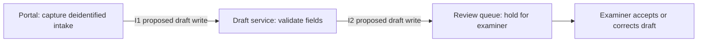

# Assisted intake architecture — decision draft

Fictional Harbor Test Mutual; US-TEST / personal-auto-test. Review date: 2026-09-20. This is an internal draft for named owners, not legal, claims, procurement or deployment approval. Sources are synthetic supplied assertions and were not independently authenticated. No system connection, claim action, customer message or implementation occurred.

Mira Chen should review the proposed three-component sandbox design, its exact payload contract and its failure tests before any implementation decision. ARC-17 v3 (2026-09-18, raw-evidence.json#/architecture) provides component options, responsibility and monthly cost assumptions. SUP-1 v1 (2026-09-19, supplemental-evidence.json#/design_proposal) supplies a fictional design proposal; it does not describe an installed connector. PROFILE-architecture v1 governs only this sandbox method and scope.

| Component / owner | Proposed option / alternative | Tradeoff | USD per stated month |
|---|---|---|---:|
| Portal / Mira Chen | Web form / examiner keyed form | Faster capture; browser dependency | 280 |
| Draft service / Noah Vale | Stateless rules / manual checklist | Consistent checks; rules maintenance | 420 |
| Review queue / Elena Moss | Durable queue / shared task list | Replayable drafts; queue administration | 160 |

The supplied total is $860 per September 2026 budget month at the declared sandbox load, not a production quote or fully allocated cost. Edge, service and queue are named failure domains, not evidence that their infrastructure is independent.

Both proposed interfaces use intake-draft-v1: token, capture time, supplied fields and missing fields. I1 connects portal to draft service; I2 connects draft service to review queue. Contracts require mutual service identity, sandbox draft-create permission, TLS and encryption at rest, a five-second timeout, at-least-once delivery and no more than three attempts. The intake token is the trace and idempotency key. Elena Moss owns acceptance. Readback must return one matching draft ID; an uncertain receipt stops the producer until examiner reconciliation. Failed intake stays visible in the manual examiner queue. This defines a proposal; no endpoint is live or approved. RET-3 supplies a fictional 30-day sandbox deletion rule, not a real institution retention mandate.

R1 requires draft-service p95 response latency <=700 ms at sandbox-40-requests-per-minute-2KB-v1. The observed 640 ms on September 18 meets that one requirement; it says nothing about end-to-end latency, availability, production throughput or provider conformance. Replayed native evidence (repairs folder): architecture-complete-output.json, results.requirement_fit and supplied_period_cost.

In the imperfect packet, the observed workload is 10KB, and the queue cost is unknown. Architecture-imperfect-output.json correctly leaves fit and total cost null. Do not reuse 640 ms as evidence for the 2KB requirement, or substitute zero for the quote.

Acceptance remains with Mira (component and workload scope), Noah (permission, replay and recovery tests), Elena (manual route and review operating procedure), and the institution's privacy owner (retention and data minimization). Test interrupted receipt, duplicate submission, full queue and unavailable identity service using the exact required workload. Provider selection and deployment remain open.
